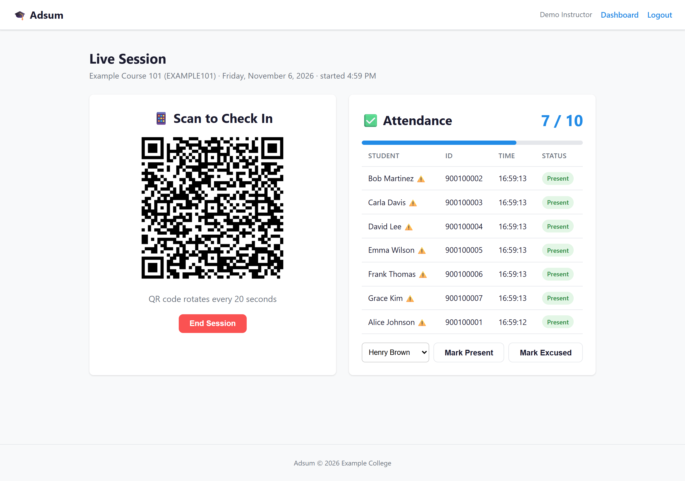
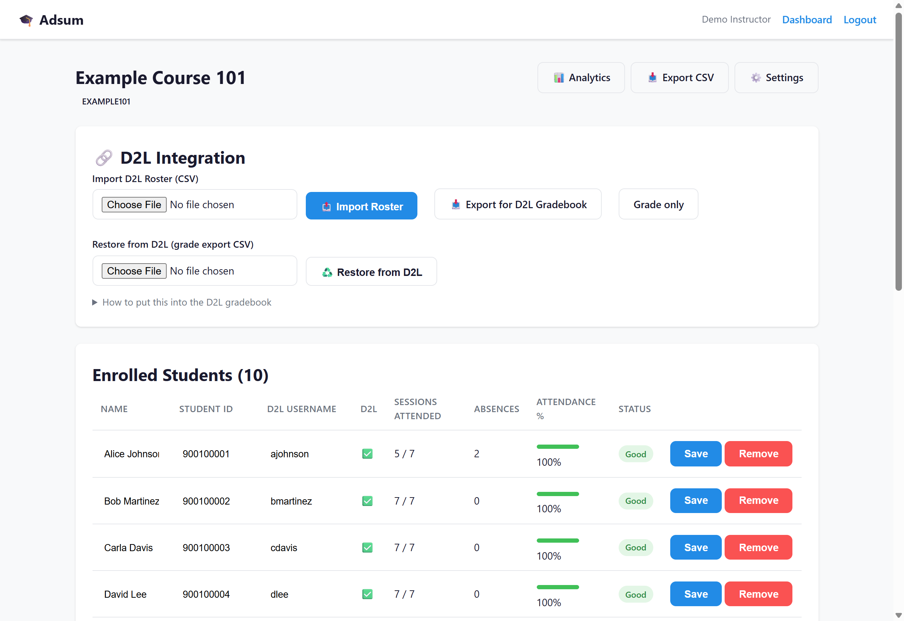
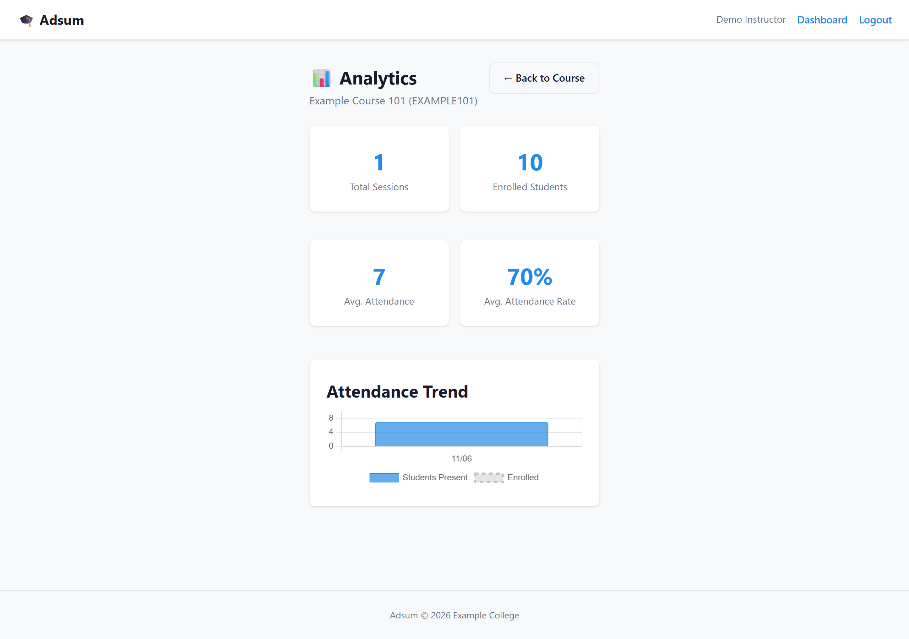

# Adsum

[](https://github.com/mrothlis/adsum/actions/workflows/ci.yml)
[](LICENSE)
[](https://www.python.org/downloads/)
[](https://github.com/mrothlis/adsum/releases)

**Classroom attendance in about four seconds, written straight into the D2L
Brightspace gradebook.**

*Adsum* is Latin for "I am present" — the answer given at roll call.

You start a session and project a QR code that changes every twenty seconds.
Students scan it with their phones and are marked present. When you want the
grades in D2L, you export one CSV and import it. That's the whole product.

Built by an instructor for his own classes, and released under the MIT licence
in case it is useful elsewhere.

---

## Contents

- [Why it exists](#why-it-exists)
- [Screenshots](#screenshots)
- [How it works](#how-it-works)
- [Features](#features)
- [Requirements](#requirements)
- [Quick start](#quick-start)
- [Connecting D2L](#connecting-d2l-lti-11)
- [Day-to-day use](#day-to-day-use)
- [Getting attendance into the gradebook](#getting-attendance-into-the-gradebook)
- [Attendance policy](#attendance-policy)
- [Why D2L holds the record](#why-d2l-holds-the-record)
- [Configuration](#configuration)
- [Roles and multi-instructor use](#roles-and-multi-instructor-use)
- [Security](#security)
- [Privacy and FERPA](#privacy-and-ferpa)
- [Backups and recovery](#backups-and-recovery)
- [Tests](#tests)
- [Deployment](#deployment)
- [Limitations](#limitations)
- [FAQ](#faq)
- [Contributing](#contributing)

---

## Why it exists

D2L Brightspace has a built-in Attendance tool. It has no API and no CSV
import, so attendance has to be entered by hand, one student at a time, every
single class ([D2L confirms there is no Valence API for attendance
registers][d2l-api]). For a 40-person class that is a few minutes of clicking
after every meeting, and nobody keeps it up.

The gradebook, unlike the attendance tool, *is* machine-writable. So Adsum
captures attendance in seconds and writes it there instead.

[d2l-api]: https://community.d2l.com/brightspace/discussion/6519/is-there-api-support-for-attendance-registers

## Screenshots

**Live session.** Project this. The list fills in as students scan, without
refreshing. Anyone whose phone fails is marked present with one click.



**Course.** Roster, session history, attendance percentages, and the export
that feeds the gradebook.



**Analytics.** Attendance trend across the term.



*All screenshots use the built-in demo data. No real students appear.*

## How it works

```
  Instructor                    Student's phone                D2L
  ----------                    ---------------                ---
  Start Session
  QR code on screen  --scan-->  check-in page
    (rotates 20s)               identified by LTI
                                tap Check In
  live list updates  <----------'
  End Session
  Export CSV         -------------------------------->  Grades -> Import
                                                          Attendance: 93
                                                          Attendance Detail:
                                                          09/01:P 09/03:A ...
```

The QR code encodes a token signed with HMAC-SHA256 over the session id and a
rotating time slot. A token is valid for its own slot and the one before it,
so it lives twenty to forty seconds. A screenshot sent to a friend outside the
room is useless by the time it arrives.

Students are identified by LTI, not by typing a name. They launch the tool
once from inside your D2L course; after that their phone is known.

## Features

**Taking attendance**
- Rotating QR check-in, signed and short-lived
- Live roster over server-sent events — no refreshing
- Sessions end when *you* end them; nothing closes on a timer
- Mark present, unmark, or excuse anyone, including on a session that already
  ended
- Optional per-course geofence with a map picker, off by default
- Optional campus-IP restriction

**Grading**
- Per-course attendance policy: forgiven absences, late threshold, and whether
  late counts as present
- Excused absences leave the denominator entirely
- One numeric gradebook column plus one Text column holding every date
- Early alerts for students below 75% or with three consecutive absences

**Operating it**
- `/healthz` for uptime monitoring
- Online SQLite backups that are safe to run while serving
- Alembic migrations
- Roster import from a D2L class list export
- Multi-instructor, with real isolation between courses

## Requirements

| | |
|---|---|
| Python | 3.11 or newer |
| Database | SQLite by default; PostgreSQL supported |
| D2L | A course you can add an External Learning Tool link to |
| Network | A public HTTPS URL students' phones can reach |

No container runtime, no message queue, no Redis. It is one Python process and
a file.

## Quick start

```bash
git clone https://github.com/mrothlis/adsum.git
cd adsum
python -m venv .venv && . .venv/bin/activate     # Windows: .venv\Scripts\activate
pip install -r requirements.txt

cp .env.example .env
python -c "import secrets; print(secrets.token_hex(32))"   # paste as SECRET_KEY
# Edit .env: SECRET_KEY, ADMIN_EMAIL, ADMIN_PASSWORD, BASE_URL, INSTITUTION_NAME

python run.py
```

Open `http://127.0.0.1:8000` and sign in with the admin credentials from
`.env`. The admin account is created automatically on an empty database.

The app refuses to start with a placeholder `SECRET_KEY` or an empty
`ADMIN_PASSWORD` unless `DEBUG=true`, so a half-configured install cannot
quietly end up in production.

**For anything beyond a local try-out, read [docs/INSTALL.md](docs/INSTALL.md).**
It covers hosting, HTTPS and reverse proxies, running as a service, backups,
upgrades, and a troubleshooting table.

## Connecting D2L (LTI 1.1)

No IT ticket required — an instructor can do this alone.

1. In Adsum: **Course → Settings**. Note the launch URL, consumer key and
   consumer secret.
2. In D2L: **Content → Add Existing Activities → External Learning Tool**.
3. Title `Adsum`, URL `https://your-host/lti/launch`, plus the key and secret.
4. Tick **Open as External Resource**.
5. Under **Security Settings**, enable **Send system username**, **Send user
   email** and **Send user name**. Without these the launch arrives
   unidentified and nobody can be matched to the roster.

Click the link once yourself to confirm it works.

> **Rotating the secret?** Change it in Adsum and in D2L at the same time.
> They must match, or every launch returns 403.

## Day-to-day use

1. **Start Session** on the course page and project the QR code.
2. Students scan. The list fills in live.
3. **End Session** when you're done.
4. Phone trouble? **Mark Present** — during or after the session.
5. Documented absence? **Excuse** — it leaves that student's denominator.

A student's very first check-in takes two scans: they scan, get sent to D2L to
sign in, and scan again. After that it's a single scan all term. Telling the
class to open the Adsum link in D2L once in week one avoids it entirely.

## Getting attendance into the gradebook

1. **Export for D2L Gradebook** on the course page.
2. In D2L: **Grades → Import**, choose the file, tick *Create new grade item
   when an unrecognized item is referenced*.
3. **Set Maximum Points to 100** for the *Attendance* item. D2L defaults it to
   **10**, which displays everyone at 1000%. The *Attendance Detail* text item
   needs no properties.
4. Continue through the preview, then Import.

You get two columns:

| Column | Type | Contents |
|---|---|---|
| `Attendance` | Numeric 0–100 | The policy-adjusted percentage |
| `Attendance Detail` | Text | `5/8 present, 3 unexcused (3 allowed) \| 09/01:P 09/03:A ...` |

Re-importing **overwrites** both columns with current running totals, so
weekly imports need no reconciliation. It also overwrites manual edits made in
D2L — correct attendance in Adsum and re-export instead.

Tick *Create new grade item* on the **first** import only.

> Fully automatic passback needs LTI 1.3 Advantage (AGS), which requires your
> IT department to register the tool. Adsum deliberately stays on LTI 1.1 so
> an individual instructor can adopt it unaided.

## Attendance policy

**Each instructor sets their own, per course**, under **Course → Settings →
Attendance Policy**. None of it is an install setting: how many absences a
student is allowed is a syllabus decision, and the person who deploys the
server has no business making it for a department. Two instructors sharing
one installation can run entirely different policies.

| Setting | Meaning | Default for a new course |
|---|---|---|
| **Unexcused absences forgiven** | How many a student may have before the percentage drops | 3 |
| **Marked late after** | Minutes from session start before a check-in records as late | 10 |
| **Late counts as present** | Off means late arrivals are labelled late *and* count as absent for grading | On |

Leave a box empty to use the default. Changing a policy re-scores that
course's existing attendance immediately — the percentage is always computed
from the records, never stored.

Excused absences are always removed from the denominator — a documented
absence neither helps nor hurts. A course with no sessions yet scores 100, so
nobody is punished in week one.

**How much attendance is worth is set in D2L**, not here. Adsum emits 0–100;
your gradebook's Maximum Points and category weighting decide what that means.
Duplicating weighting here would create two sources of truth that silently
disagree.

## Why D2L holds the record

Adsum is a capture tool, not a system of record. That is a deliberate design
constraint, and three things enforce it:

1. **The whole history ships to D2L.** The `Attendance Detail` text column
   carries every class date and status in one cell, so the gradebook holds the
   complete record — not just a summary.
2. **That column is parseable.** A D2L grade export is therefore a full
   backup. **Restore from D2L** on the course page rebuilds Adsum's sessions
   and records from it. Restoring is additive and idempotent.
3. **Export refuses to run on a course with no sessions** (HTTP 409). If the
   app were wiped mid-term, an empty export would otherwise overwrite D2L's
   copy with nothing. That cannot happen.

If Adsum disappeared tomorrow, your attendance record would still be in D2L,
readable by a human and parseable by a machine.

## Configuration

Everything lives in `.env`; `.env.example` documents all 22 settings. The ones
that matter:

| Key | Purpose |
|---|---|
| `SECRET_KEY` | **Required.** Signs session cookies *and* QR tokens. Must be random and unique per install. |
| `ADMIN_EMAIL` / `ADMIN_PASSWORD` | **Required.** Bootstrap admin, created on an empty database. |
| `BASE_URL` | Public URL embedded in every QR code. Must be the external HTTPS address. |
| `INSTITUTION_NAME`, `D2L_HOST`, `LTI_CONSUMER_KEY` | Institution identity. |
| `QR_ROTATION_SECONDS` | Rotation interval (20). A token lives 20–40s. |
| `DISPLAY_TIMEZONE` | Display zone. Timestamps are stored as UTC. |
| `DEFAULT_GEOFENCE_LAT/LON/RADIUS_M` | Starting position of the map picker. |
| `DATABASE_URL` | SQLite by default. |
| `SEED_DEMO` | `true` creates a demo course. Development only. |
| `DEBUG` | Leave `false` outside local development. |

Never commit `.env`.

**Attendance policy is not in here.** Forgiven absences, the late threshold
and whether late counts as present are set per course by each instructor —
see [Attendance policy](#attendance-policy). Whoever installs the server does
not decide how many absences a colleague's students are allowed.

## Roles and multi-instructor use

- **Instructor** — sees and manages only their own courses. Cannot reach
  another instructor's courses, rosters, sessions or attendance.
- **Admin** — additionally manages the shared D2L host and LTI credentials
  that every course on the installation depends on.

The separation is enforced on every route and asserted by two test suites that
run in CI, because a privacy regression here is the worst thing this app could
do.

## Security

- **Session cookies and QR tokens** are signed with `SECRET_KEY`
  (`itsdangerous`, HMAC-SHA256). Passwords use PBKDF2-SHA256.
- **Login throttling**: five failures per IP, then a ten-minute lockout.
- **LTI 1.1 launches** are verified as OAuth 1.0a HMAC-SHA1 signatures; a bad
  signature is rejected.
- **The app refuses to start** outside `DEBUG` with a placeholder or short
  `SECRET_KEY`, or an empty `ADMIN_PASSWORD`.
- **Student pages load no third-party resources.** Leaflet and Chart.js appear
  only on instructor screens.

Report vulnerabilities privately — see [SECURITY.md](SECURITY.md).

## Privacy and FERPA

Attendance records are student education records, protected by FERPA in the US
and equivalent rules elsewhere. Whoever deploys this is responsible for
hosting it accordingly.

- **Raw GPS is never stored.** Location is checked once against the classroom
  geofence; only the distance in metres and an in/out flag are persisted.
- Students see a notice before any location check.
- The geofence is **off by default** and enabled per course.
- No analytics, no tracking, no third-party data sharing.

## Backups and recovery

Two independent layers, and you want both.

**The database.** `backup_db.py` uses SQLite's online backup API, so it is safe
while the app is serving. It keeps the last 14 copies in `backups/` and reads
the database location from `DATABASE_URL`.

```bash
python backup_db.py              # run nightly from cron or Task Scheduler
```

**D2L itself.** Because the `Attendance Detail` column is round-trippable, a
D2L grade export is a complete backup. Use **Restore from D2L** on the course
page. This is verified end to end: the test suite wipes a course and rebuilds
it from an export alone.

## Tests

```bash
python scripts/verify_install.py         # clean-install check; no server needed
python scripts/smoke_test.py             # end-to-end happy path
python scripts/test_isolation.py         # one instructor cannot reach another's data
python scripts/test_admin_separation.py  # non-admins cannot change shared config
ruff check app scripts run.py backup_db.py
```

`verify_install.py` exports the committed tree with `git archive`, configures
it from `.env.example` alone, and starts it — proving a fresh clone works. It
also fails if a secret, a database, or a personal identifier is ever
committed.

The other three run against a live instance, read `BASE_URL`, `ADMIN_EMAIL`
and `ADMIN_PASSWORD` from the environment or `.env`, and pick their target
course automatically (`TEST_COURSE_ID` overrides). They create and clean up
their own throwaway records.

All of them run on every push via
[GitHub Actions](.github/workflows/ci.yml), across Python 3.11, 3.12 and 3.13.

## Deployment

[docs/INSTALL.md](docs/INSTALL.md) is the full guide: hosting options, HTTPS
via reverse proxy or tunnel, running under systemd or Task Scheduler, backups,
upgrades, verification and troubleshooting.
[docs/DEPLOY.md](docs/DEPLOY.md) covers the original Windows setup.

Two proxy details are worth knowing, because both fail silently:

- **Forward `X-Forwarded-For`**, or the login throttle sees every request as
  one IP and a single person's failures lock out the whole class.
- **Disable buffering for server-sent events**, or the live attendance list
  never updates.

SQLite is fine at course or department scale. Point `DATABASE_URL` at
PostgreSQL for anything larger. There is no container image: it is a plain
`uvicorn` process, so run it under whatever your institution already uses.

## Limitations

Worth knowing before you adopt it.

- **LTI 1.1, not 1.3.** Grades move by CSV export and import, not automatic
  passback. This is deliberate — 1.3 requires IT to register the tool, which
  defeats the point of an instructor adopting it alone.
- **A student's first check-in needs two scans**, because they must sign in to
  D2L in between and the first token expires while they do.
- **D2L truncates usernames and emails to 20 characters.** That truncated form
  is the real identity for both launches and gradebook imports. Don't "correct"
  it by hand.
- **Re-importing overwrites manual gradebook edits.** Correct attendance in
  Adsum, not in D2L.
- **Deleting a session changes everyone's percentage**, because it changes the
  denominator.
- **No mobile app.** It is a web page; students need a working camera and a
  browser.

## FAQ

**Does this work with Canvas, Moodle or Blackboard?**
Not today. The LTI 1.1 launch is standard and would likely work, but the
gradebook export is written to D2L's import format. Porting it means a new
exporter, not a rewrite.

**What if a student has no phone, or a dead battery?**
Mark them present with one click, during or after the session.

**Can students check in from outside the room?**
The code changes every twenty seconds, so a forwarded screenshot is stale on
arrival. If you want a hard guarantee, enable the geofence or restrict to
campus IP ranges — both are per course.

**Does the session close automatically?**
No. It accepts check-ins until you end it. Someone arriving late is a
conversation, not a lockout.

**What happens if the app breaks mid-semester?**
Your record is in D2L. Reinstall, then use Restore from D2L with a grade
export.

**Can two instructors share one installation?**
Yes. Each sees only their own courses, and each sets their own attendance
policy. Shared D2L credentials are admin-only.

**Does it need to run on a university server?**
No. Any host with a public HTTPS address works, including a small VM or a
tunnel from a desktop. Institutional hosting is the right answer once more
than a couple of people depend on it.

## Contributing

Bug reports and pull requests are welcome — see
[CONTRIBUTING.md](CONTRIBUTING.md) for setup, the test suite, and the design
principles a change is weighed against. The main one: **D2L is the system of
record, and Adsum is the pipe.** Changes that make the app irreplaceable are
likely to be declined.

Release notes are in [CHANGELOG.md](CHANGELOG.md).

## Tech stack

Python 3.11+, FastAPI, SQLAlchemy (async), SQLite by default, Alembic for
migrations. Jinja2 templates with vanilla JavaScript — no build step. Leaflet
for the map picker, Chart.js for trends, both instructor-only.

## Licence

MIT — see [LICENSE](LICENSE) for the full text and copyright holder.
